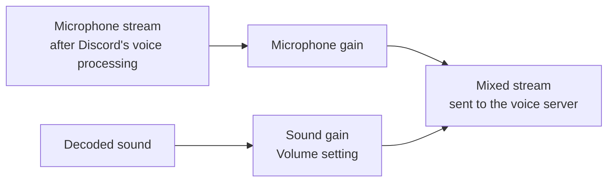

# How SoundboardToVoice works

**English** | [Русский](../ru/how-it-works.md)

This document explains the design for people who want to maintain or change the plugin. For installation and usage see the [README](../../README.md).

## The problem

Discord's official soundboard does not send audio from your client. The client asks the server to play a sound, the server checks Nitro and permissions, and every client then plays the file locally. To get around those checks, the sound has to travel as *your voice*.

That is easy in the browser, where the microphone is a Web Audio stream. Discord Desktop is different: it has two voice engines, and by default it uses the native one (`discord_voice.node`). The native engine captures the microphone itself, outside of JavaScript, and its API has no way to inject audio into the outgoing stream. It can only play samples locally.

So the plugin does three things:

1. On Discord Desktop, make the client use its WebRTC engine instead of the native one.
2. Take over the microphone stream of that engine and mix sounds into it.
3. Unlock the soundboard UI and redirect the click to the mixer.

All patches live in [`patches.ts`](../../patches.ts), in four groups that match the sections below.

## 1. Switching the voice engine (`enginePatches`)

These patches apply only on Discord Desktop and only while the *Force WebRTC* setting is on. Vesktop and the browser already use the WebRTC engine.

| Patch | Why it is needed |
|---|---|
| Engine selection: `[NATIVE, WEBRTC].find(supported)` becomes `[WEBRTC].find(supported)` | Discord picks the first supported engine. The WebRTC engine already reports Electron as supported. |
| `fetchDave: isWeb()` becomes `fetchDave: true` | Discord voice requires DAVE end-to-end encryption. The WebRTC engine loads its DAVE module only on web, so on desktop it would announce "no DAVE" and the voice server would close the connection with code 4017. The visible symptom is a connection stuck on "Authenticating". |
| Every `"Chrome" === browser.name` check also accepts `"Electron"` | The capability table (video, stats, connection state events) is keyed by browser name. Without this the client shows "Video and Screen Share are not supported in this browser". |
| `VOICE_PROCESSING` support returns `true` | Same browser check, for echo cancellation, noise suppression and automatic gain. |

## 2. Owning the microphone stream (`audioPatches`)

The WebRTC engine has an `AudioInput` class. It calls `getUserMedia`, stores the result in `this.stream`, and the connection sends that stream. Four replacements, applied as one group, hook into it:

| Hook | Plugin method | Purpose |
|---|---|---|
| After the stream is acquired | `mixInput(input, stream)` | Returns a new stream that Discord sends instead. |
| When a stream is released | `releaseInput(stream)` | Tears the mixer down and stops the real microphone tracks. |
| `track.enabled = !mute` | `shouldEnableInput(input)` | Keeps the track enabled while a sound plays during mute. |
| `setSpeaking(value)` | `resolveSpeaking(input, value)` | Holds the speaking flag while a sound plays. |

### The audio graph

The sound joins *after* Discord's noise suppression and echo cancellation, so those never filter it out. Voice activity detection runs on the mixed stream, so a sound also counts as activity.

### Speaking, mute and push to talk

Your client tells the voice server when you start and stop speaking, and audio sent outside of that window is not reliably heard by others. The mixer therefore tracks two things per input: what Discord last asked for (`requestedSpeaking`), and whether a sound is playing.

- **Speaking flag**: the effective value is `requested || playing`. When the last sound ends, the flag goes back to whatever Discord last asked for, so a user who is still talking is not cut off.
- **Mute**: the microphone gain is 0. With *Play While Muted* on, the track is re-enabled for the duration of the sound, so only the sound is sent. With it off, a muted user sends nothing and muting mid-sound stops the sound.
- **Push to talk**: during a sound the microphone gain follows the key. Sounds go out without the key, and the microphone opens only while the key is really held.

This logic is in [`mixer.ts`](../../mixer.ts). It imports nothing from Vencord or Discord, which is why [`tests/mixer.test.mjs`](../../tests/mixer.test.mjs) can exercise every rule above with fake audio nodes.

## 3. The soundboard UI (`soundboardPatches`, `nitroPatches`)

| Patch | Effect |
|---|---|
| `available: sound.available` becomes `true` | Sounds of servers that lost their boost level stay usable. FakeNitro has the same patch, so this one is marked `noWarn`. |
| *Use External Sounds* permission check returns `true` (two places) | Other servers' sounds are listed and usable in any channel. |
| *Use Soundboard* permission is dropped from the channel check | The soundboard opens in channels where the permission is denied. *Speak* is still required. |
| `canUseSoundboardEverywhere` returns `true` (*Unlock All Sounds* setting) | Removes the Nitro lock on sounds from other servers. |
| The "send sound" function starts with `return $self.playSound(sound, channelId)` | The request to Discord's server is never made. |

`playSound` in [`index.ts`](../../index.ts) then:

1. fetches the file from Discord's CDN (`sounds.ts` caches the encoded bytes of recently used sounds);
2. decodes it and hands the buffer to the mixer;
3. dispatches `GUILD_SOUNDBOARD_SOUND_PLAY_LOCALLY` so Discord plays it to you the usual way (*Hear Sounds* setting), and `SOUNDBOARD_TRACK_USAGE` so the "frequently used" list keeps working.

## When a Discord update breaks a patch

1. Run `node tools/check-patches.mjs`. It reports each patch as `ok` or `FAIL`, and says whether the `find` or a `match` stopped matching.
2. The bundle it downloaded is in your temp folder under `soundboard-to-voice/`. Search it for the stable strings near the broken patch (for example `AudioInput: No MediaStream` or `SEND_SOUNDBOARD_SOUND`) and compare the new code with the excerpt in [`tests/patches.test.mjs`](../../tests/patches.test.mjs).
3. Update the regex in `patches.ts` and the excerpt in the test. Use `\i` for minified identifiers, never the current one-letter names.
4. Run `node --test "tests/*.test.mjs"` and the checker again, rebuild Vencord, restart Discord.

## Approaches that were ruled out

- **Injecting into the native engine.** `discord_voice.node` exposes local sample playback and a launch flag that replaces the microphone with a file. Neither can add audio to a live outgoing stream.
- **A virtual audio cable.** Routing microphone and sounds through a virtual device works with the native engine, but it needs a third-party driver and Discord's noise suppression then removes most sound effects.
