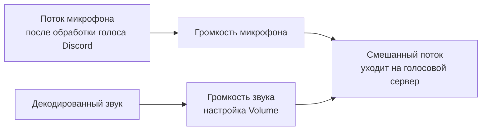

# Как работает SoundboardToVoice

[English](../en/how-it-works.md) | **Русский**

Этот документ описывает устройство плагина для тех, кто хочет его поддерживать или менять. Установка и использование описаны в [README](../../README.ru.md).

## Задача

Официальный саундборд Discord не отправляет звук с вашего клиента. Клиент просит сервер проиграть звук, сервер проверяет Nitro и права, после чего каждый клиент проигрывает файл у себя. Чтобы обойти эти проверки, звук должен идти как *ваш голос*.

В браузере это просто: микрофон там — поток Web Audio. С Discord Desktop иначе: у него два голосовых движка, и по умолчанию используется нативный (`discord_voice.node`). Нативный движок сам захватывает микрофон, вне JavaScript, и в его API нет способа подмешать звук в исходящий поток — есть только локальное воспроизведение.

Поэтому плагин делает три вещи:

1. В Discord Desktop заставляет клиент использовать WebRTC-движок вместо нативного.
2. Забирает под управление поток микрофона этого движка и подмешивает в него звуки.
3. Снимает ограничения в интерфейсе саундборда и перенаправляет нажатие в микшер.

Все патчи находятся в [`patches.ts`](../../patches.ts), в четырёх группах, которым соответствуют разделы ниже.

## 1. Переключение голосового движка (`enginePatches`)

Эти патчи применяются только в Discord Desktop и только при включённой настройке *Force WebRTC*. Vesktop и браузер и так используют WebRTC-движок.

| Патч | Зачем нужен |
|---|---|
| Выбор движка: `[NATIVE, WEBRTC].find(supported)` превращается в `[WEBRTC].find(supported)` | Discord берёт первый поддерживаемый движок. WebRTC-движок уже считает Electron поддерживаемым. |
| `fetchDave: isWeb()` превращается в `fetchDave: true` | Голос Discord требует сквозного шифрования DAVE. WebRTC-движок загружает модуль DAVE только в браузере, поэтому в приложении он сообщил бы серверу «DAVE нет», и сервер закрыл бы соединение с кодом 4017. Внешне это выглядит как соединение, зависшее на «Authenticating». |
| Каждая проверка `"Chrome" === browser.name` принимает и `"Electron"` | Таблица возможностей (видео, статистика, события состояния соединения) привязана к имени браузера. Без патча клиент показывает «Video and Screen Share are not supported in this browser». |
| Поддержка `VOICE_PROCESSING` возвращает `true` | Та же проверка браузера, но для эхоподавления, шумоподавления и автоусиления. |

## 2. Управление потоком микрофона (`audioPatches`)

В WebRTC-движке есть класс `AudioInput`. Он вызывает `getUserMedia`, сохраняет результат в `this.stream`, и соединение отправляет этот поток. В класс встроены четыре замены, которые применяются одной группой:

| Точка | Метод плагина | Назначение |
|---|---|---|
| После получения потока | `mixInput(input, stream)` | Возвращает новый поток, который Discord отправляет вместо исходного. |
| При освобождении потока | `releaseInput(stream)` | Разбирает микшер и останавливает настоящие дорожки микрофона. |
| `track.enabled = !mute` | `shouldEnableInput(input)` | Оставляет дорожку включённой, пока в муте играет звук. |
| `setSpeaking(value)` | `resolveSpeaking(input, value)` | Удерживает статус «говорит», пока играет звук. |

### Аудиограф

Звук подмешивается *после* шумоподавления и эхоподавления Discord, поэтому они его не вырезают. Определение голосовой активности работает на смешанном потоке, так что звук тоже считается активностью.

### Статус «говорит», мут и рация

Клиент сообщает голосовому серверу, когда вы начинаете и заканчиваете говорить, и звук, отправленный вне этого промежутка, остальные слышат ненадёжно. Поэтому микшер хранит для каждого входа две вещи: что в последний раз запросил сам Discord (`requestedSpeaking`) и играет ли сейчас звук.

- **Статус «говорит»**: итоговое значение — `запрошено || играет звук`. Когда заканчивается последний звук, статус возвращается к тому, что запрашивал Discord, поэтому пользователя, который продолжает говорить, не обрывает.
- **Мут**: громкость микрофона равна 0. При включённой настройке *Play While Muted* дорожка включается на время звука, и отправляется только звук. При выключенной в муте не отправляется ничего, а включение мута посреди звука останавливает звук.
- **Рация (push to talk)**: во время звука громкость микрофона следует за клавишей. Звук уходит без нажатия, а микрофон открывается, только пока клавиша действительно зажата.

Эта логика находится в [`mixer.ts`](../../mixer.ts). Файл ничего не импортирует из Vencord и Discord, поэтому [`tests/mixer.test.mjs`](../../tests/mixer.test.mjs) проверяет каждое правило выше на поддельных аудиоузлах.

## 3. Интерфейс саундборда (`soundboardPatches`, `nitroPatches`)

| Патч | Результат |
|---|---|
| `available: sound.available` превращается в `true` | Звуки серверов, потерявших уровень буста, остаются доступными. Такой же патч есть в FakeNitro, поэтому этот помечен `noWarn`. |
| Проверка права «Использовать внешние звуки» возвращает `true` (в двух местах) | Звуки других серверов показываются и работают в любом канале. |
| Право «Использовать звуковую панель» убрано из проверки канала | Саундборд открывается в каналах, где это право запрещено. Право «Говорить» по-прежнему требуется. |
| `canUseSoundboardEverywhere` возвращает `true` (настройка *Unlock All Sounds*) | Снимает блокировку Nitro со звуков других серверов. |
| Функция «отправить звук» начинается с `return $self.playSound(sound, channelId)` | Запрос к серверу Discord не выполняется вообще. |

Дальше `playSound` из [`index.ts`](../../index.ts):

1. загружает файл с CDN Discord (`sounds.ts` кэширует закодированные данные недавно использованных звуков);
2. декодирует его и передаёт буфер микшеру;
3. отправляет событие `GUILD_SOUNDBOARD_SOUND_PLAY_LOCALLY`, чтобы Discord проиграл звук вам обычным способом (настройка *Hear Sounds*), и `SOUNDBOARD_TRACK_USAGE`, чтобы продолжал работать список «часто используемых».

## Если обновление Discord сломало патч

1. Запустите `node tools/check-patches.mjs`. Скрипт помечает каждый патч как `ok` или `FAIL` и сообщает, что именно перестало совпадать: `find` или `match`.
2. Скачанный бандл лежит во временной папке, в `soundboard-to-voice/`. Найдите в нём устойчивые строки рядом со сломанным патчем (например, `AudioInput: No MediaStream` или `SEND_SOUNDBOARD_SOUND`) и сравните новый код с фрагментом в [`tests/patches.test.mjs`](../../tests/patches.test.mjs).
3. Обновите регулярное выражение в `patches.ts` и фрагмент в тесте. Для минифицированных идентификаторов используйте `\i`, а не текущие однобуквенные имена.
4. Запустите `node --test "tests/*.test.mjs"` и проверку патчей ещё раз, пересоберите Vencord, перезапустите Discord.

## Отвергнутые подходы

- **Вставка звука в нативный движок.** `discord_voice.node` умеет локально проигрывать сэмплы и поддерживает флаг запуска, заменяющий микрофон файлом. Ни то, ни другое не позволяет добавить звук в живой исходящий поток.
- **Виртуальный аудиокабель.** Направить микрофон и звуки через виртуальное устройство можно и с нативным движком, но для этого нужен сторонний драйвер, а шумоподавление Discord вырезает большую часть звуковых эффектов.
